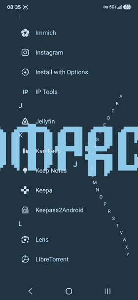

# Omagara

A Niagara-inspired OWL 21 full-screen widget for Omalauncher.

## v1.3

- Dismiss an entire notification stack with its X or a swipe; non-clearable notifications remain.
- Magnetic swipe resistance and snap-back at breakaway, with one haptic tap for a single notification and two spaced taps for a stack.
- Keep notification cards visible throughout a swipe, including over bright wallpapers.
- Drag the elastic alphabet toward either screen edge; release springs it back. Reduce motion snaps back immediately.

Square and rounded appearance options, icon overlays, app search, calendar, clock, and notification actions remain available.

## Screenshot

Phone screenshot captured with Omalauncher, resized for the store preview.

## Launcher limitations

- Home or Back cannot dismiss alphabet browsing through OWL 21.
- Contact search is not exposed to OWL 21.
- OWL 21 does not expose adjustable haptic strength.
